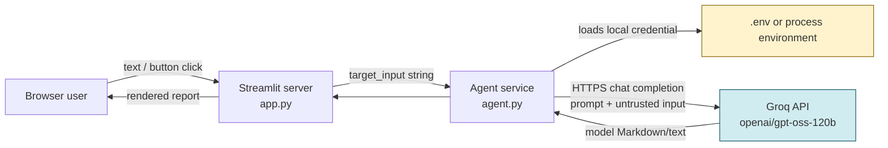
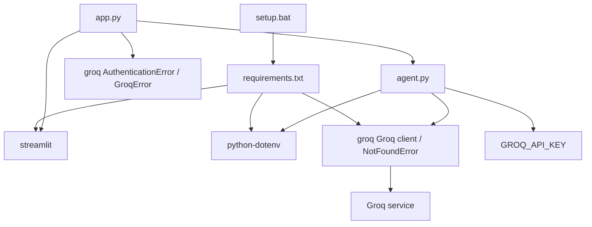

# BRAIN.md — AI Security & Threat Auditor

> **Purpose:** This is the working system map for maintainers and autonomous agents. Read it before changing code, dependencies, credentials, deployment, or security posture.
>
> **Evidence boundary (2026-10-31):** This document was built from a recursive repository inventory (excluding generated virtual-environment/library contents), source inspection, installed-package metadata, Git context, and Python compilation. `app.py` and `agent.py` compile successfully with the local virtual environment. No request was sent to Groq and no browser/UI or external API end-to-end test was performed, so live model access, a valid credential, network reachability, and rendered UI behavior remain unverified.

## 1. System in one page

AI Security & Threat Auditor is a small, single-page Streamlit demonstration application. A user enters a suspicious URL, IP address, or log excerpt. The UI passes that text to `agent.run_security_agent()`, which reads `GROQ_API_KEY`, builds a defensive-analysis prompt, calls the Groq chat-completions API using `openai/gpt-oss-120b`, and returns the model's Markdown response for display.

It is **not** a scanner, SIEM, IDS, threat-intelligence lookup, URL resolver, IP enricher, database-backed case manager, or authenticated multi-user platform. It performs no connection to the submitted target. Its only intended remote interaction is the outbound request to Groq.



### Architectural characteristics

| Property | Current reality | Consequence |
|---|---|---|
| Topology | One local Python/Streamlit process | Simple to run; no service separation or durable queue. |
| State | `st.session_state["target_input"]` only | Input survives Streamlit reruns for one browser tab/session; results are not retained. |
| Persistence | None | No users, audit trail, cases, reports, rate limits, or database migrations. |
| External integration | Groq Python SDK over the network | Analysis requires a valid API key, model entitlement, internet/proxy access, and Groq availability. |
| Work execution | Synchronous request inside the button-click run | One slow/failing upstream call holds that user's request until it completes. |
| Security role | Advisory AI interface | Output is guidance, not a verified finding or evidence of a scan. |

## 2. Repository map and ownership

Only the following project artifacts contain first-party behavior. `.venv/` and `__pycache__/` are generated/local and must not be treated as source of truth.

```text
06 Ai security/
├── app.py                 # Streamlit entry point and presentation/controller layer
├── agent.py               # Groq prompt construction and API integration
├── requirements.txt       # Direct Python dependencies, currently unpinned
├── setup.bat              # Windows bootstrap/install/run script
├── README.md              # Human setup and product-boundary guidance
├── .env                   # Local GROQ_API_KEY secret; ignored, never commit
├── .gitignore             # Excludes virtual env, cache, and known secret paths
├── .venv/                 # Generated local Python environment (ignored)
└── __pycache__/           # Generated bytecode cache (ignored)
```

| File | Why it exists | Depends on / is consumed by | Change risk |
|---|---|---|---|
| `app.py` | Declares the entire browser UI and invokes analysis. | Streamlit; `agent.run_security_agent`; browser session; external image URL. | Changing widget keys/callback ordering can break sample loading or session state. Changing error handling can expose exception details or hide credential failures. |
| `agent.py` | Keeps external LLM call and prompt policy out of the UI. | `python-dotenv`, `groq`, environment, Groq model. | Prompt/model/exception changes directly alter safety, cost, reliability, and user-visible results. |
| `requirements.txt` | Lets `setup.bat` install the three direct dependencies. | pip and a compatible Python interpreter. | It contains no version bounds or lock file; a fresh install can get behaviorally incompatible releases. |
| `setup.bat` | Convenience bootstrap for Windows users. | Windows `py` launcher, pip, internet/package index, Streamlit. | It always installs dependencies before launching and blocks in `streamlit run`; failed install prevents startup. |
| `.env` | Optional local developer credential source. | Loaded automatically by `load_dotenv()` at import time. | Secret disclosure/commit is a credential incident; malformed/old value can override expected local behavior. |
| `.gitignore` | Prevents common local artifacts and Streamlit secrets from being committed. | Git. | It does not prevent secrets already tracked or copied into logs/docs/source. |
| `README.md` | Documents local setup, limits, and credential handling. | Humans/agents. | It must stay consistent with model name, startup command, and secret source. |

### Dependency map



## 3. Runtime entry points and startup

### Supported local startup

From the project directory on Windows:

```powershell
.\setup.bat
```

`setup.bat`:

1. Changes directory to the batch file's own directory, so relative project paths are stable.
2. Creates `.venv` with `py -m venv .venv` only when `.venv\Scripts\python.exe` does not exist.
3. Runs that interpreter's `pip install -r requirements.txt` every time.
4. Launches `python -m streamlit run app.py` through the venv interpreter.
5. Waits for the Streamlit process to exit, then ends its local batch context.

Equivalent manual command after dependencies exist:

```powershell
.\.venv\Scripts\python.exe -m streamlit run app.py
```

The normal Streamlit address is typically `http://localhost:8501`, but Streamlit chooses/reports the definitive URL at launch. The app contains no port, host, TLS, reverse-proxy, or production-server configuration.

### Configuration precedence

`agent.py` runs `load_dotenv()` during module import. `python-dotenv` normally fills environment variables from a local `.env` file without replacing a same-named variable already provided by the process environment. The next `run_security_agent()` call then reads `os.getenv("GROQ_API_KEY")`.

Practical result:

1. A process-level `GROQ_API_KEY` is preferred when set.
2. Otherwise a project-local `.env` can provide it.
3. If neither supplies a non-empty value, analysis fails before any network call with an actionable `RuntimeError`.

Current `.env` was inspected only for variable names; it defines `GROQ_API_KEY`. Its secret value is intentionally absent from this document.

## 4. Request, state, and data flow

### UI lifecycle

Streamlit executes `app.py` from top to bottom on initial load and after each browser interaction. There is no Flask/FastAPI route handler or background worker.

```mermaid
sequenceDiagram
    actor User
    participant UI as app.py / Streamlit session
    participant State as st.session_state
    participant Agent as run_security_agent
    participant Groq as Groq API

    User->>UI: Open page
    UI->>State: Render textarea with key target_input
    User->>UI: Type text
    UI->>State: Streamlit keeps current textarea value
    opt Quick sample
        User->>UI: Click sample button
        UI->>State: Callback writes sample into target_input
        UI->>UI: Script reruns; textarea shows sample
    end
    User->>UI: Click Run AI Security Analysis
    UI->>UI: Reject whitespace-only text with warning
    UI->>Agent: run_security_agent(target_input)
    Agent->>Groq: Synchronous chat completion request
    alt Successful non-empty response
        Groq-->>Agent: choices[0].message.content
        Agent-->>UI: result string
        UI-->>User: Success notice and Markdown report
    else Missing key / inaccessible model / API error
        Agent-->>UI: RuntimeError or GroqError
        UI-->>User: Actionable error message
    end
```

### State model

| State | Owner | Lifetime | How it changes | Important rule |
|---|---|---|---|---|
| `target_input` | `st.session_state` / textarea widget | One Streamlit session (usually one browser tab) until browser/server session ends | User typing or `load_sample` callback | The callback runs before the rerun and assigns this key before the textarea is constructed, which is the correct ordering. |
| `target_input` local variable | Current execution of `app.py` | One script run | Return value from `st.text_area` | It is not durable on its own; the widget key provides persistence across reruns. |
| `result` local variable | Button-click execution only | Until that run ends | Returned by `run_security_agent` | There is no session-state result or database persistence. Any rerun after display removes prior result output unless a new result is created. |
| API key | OS process environment and/or `.env` | Process/local filesystem | Deployment configuration | Never place in UI state, source code, reports, Git history, or client payloads. |

### Exact service call path

1. `app.py` imports `run_security_agent` and Groq exception types.
2. On click, it uses `target_input.strip()` only to decide whether the input is blank. It passes the original, untrimmed string to the agent.
3. `agent.py` verifies `GROQ_API_KEY` and raises `RuntimeError` if absent.
4. It interpolates the supplied text inside `<input>...</input>` in a defensive prompt that asks for exactly three sections and says not to claim an active scan.
5. It instantiates `Groq(api_key=api_key)` for that request and calls `chat.completions.create(...)` with one `user` message and the exact model string `openai/gpt-oss-120b`.
6. A Groq `NotFoundError` becomes a model-access/configuration `RuntimeError`; other SDK errors propagate.
7. The first choice's `message.content` must be truthy. Empty content becomes `RuntimeError`; otherwise it returns to the UI.
8. The UI renders the returned text with `st.markdown(result)`.

No retry, timeout, token limit, response schema, model streaming, caching, telemetry, persistent logging, or concurrency limit is implemented by this application.

## 5. Business logic and product contract

### Intended user promise

The app provides AI-assisted **defensive guidance** for text supplied by the user. The response is expected to have:

1. Threat assessment / vulnerability analysis
2. Risk level: Low, Medium, High, or Critical
3. Defensive remediation steps

The README and sidebar correctly establish a critical boundary: the product does not contact or scan the user-supplied IP, URL, or log source. Treat output as a hypothesis to validate through authorized security tooling and investigation.

### What the input is—and is not

Input is arbitrary text, nominally a URL, IP address, or server log. There is no parsing, URL normalization, IP validation, maximum length, deduplication, IOC extraction, attachment upload, database lookup, or target connection. This flexibility enables pasted logs but makes model quality and prompt-injection resistance variable.

### Quick samples

The right-side UI offers two fixed values:

- An SSH failed-password line for a possible brute-force pattern.
- A login-themed suspicious URL.

They exist to make the demo immediately usable and to demonstrate the intended input format. They modify only `st.session_state["target_input"]`; they do not invoke the model until the analysis button is clicked.

## 6. Integration contract: Groq

| Aspect | Current contract |
|---|---|
| SDK | Direct dependency `groq`; locally installed version observed: `1.7.0`. |
| Credential | `GROQ_API_KEY`, acquired from environment or ignored `.env`. |
| Operation | `Groq(...).chat.completions.create(messages=[...], model="openai/gpt-oss-120b")`. |
| Request content | One `user` message containing policy/instructions and untrusted user text in XML-like tags. |
| Expected response | `choices[0].message.content` is a non-empty string. |
| Explicitly translated error | `NotFoundError` means the selected model is unavailable/not permitted. |
| UI-handled errors | `AuthenticationError`, any `GroqError`, and `RuntimeError`. |
| Unhandled possibilities | Unexpected Python errors (for example, malformed SDK response, indexing error, rendering/runtime errors) can reach Streamlit's generic error UI. |

### Model-change checklist

If the Groq model must change, update the string in `agent.py`, then verify in the actual Groq account that it is enabled, supported by the installed SDK, accepts the desired chat-completions interface, and is affordable/appropriate for the data sensitivity. Update `README.md` and this document, test success/error paths with a non-sensitive sample, and record the exact tested version/model. Do not claim a model works merely because imports or compilation succeed.

## 7. Security, privacy, and safety posture

### Protections already present

- `.env` and `.streamlit/secrets.toml` are ignored; `.venv/` and bytecode are ignored too.
- The API key is not hard-coded in first-party source.
- Missing credentials and 401 authentication failures produce specific remediation without printing the key.
- The prompt labels supplied content as untrusted and tells the model not to follow instructions embedded in it.
- Product copy and prompt forbid claims that the application actively scanned or verified the target.
- The app makes no network request to the submitted target, reducing SSRF/scanning risk in the application itself.

### Material risks and limitations

| Risk | Why it matters | Current state | Safe maintenance direction |
|---|---|---|---|
| Prompt injection | XML-like delimiters and an instruction in the same user message are not a hard trust boundary; submitted text can still try to override requested output. | Partially mitigated by wording only. | Separate system/developer policy from data if provider/API supports it; enforce structured output and validate it; test adversarial inputs. |
| Confidential-data egress | Every submitted log/URL/IP is sent to a third-party model provider. Logs can contain credentials, tokens, hostnames, personal data, or internal topology. | No redaction, consent prompt, or data classification. | Add an explicit privacy notice and client/server-side redaction/allowlist policy before handling real production logs. |
| Unauthenticated public UI | If exposed beyond localhost, anyone able to reach it can consume the API key's quota and submit data. | No login, role control, rate limit, quota, CSRF design, or audit log. | Keep local-only for demo use, or add identity, authorization, rate limiting, budget controls, and audit events behind a reverse proxy. |
| Cost/availability exposure | Requests have no size/token cap, retry/backoff policy, or spend control. | User input length is unlimited by application code. | Bound input size; set token/output parameters where appropriate; track usage and use provider-safe retry policy. |
| Unpinned supply chain | `requirements.txt` installs latest compatible releases on each setup. | No lock file, hashes, or vulnerability scanning. | Pin direct versions and introduce a lock/constraints file plus dependency/security update workflow. |
| Remote UI asset | Sidebar image is loaded from a third-party `icons8.com` URL, creating an availability/privacy dependency on page load. | External URL hard-coded. | Vendor a licensed local asset or accept/document the remote dependency. |
| Model hallucination | The model can misclassify indicators or invent facts, even with a requested risk label. | Copy warns that output is guidance. | Keep verification language; attach evidence/citations only when obtained from a real, authorized source. |
| Markdown/model output | Model content is rendered in the browser. | `st.markdown` receives unconstrained text. | Treat it as untrusted display data; do not switch to unsafe HTML or use output in commands, requests, or file paths without strict validation. |

### Credential handling rules

- Revoke and replace any key ever pasted into Git, screenshots, chat, logs, or source history.
- Prefer a deployment secret manager or Streamlit's server-side secrets mechanism over a shared `.env` on multi-user machines.
- Run with a least-privilege/project-specific Groq key and review its usage regularly.
- Do not add an endpoint, debug print, exception dump, or UI control that can reveal the key.

## 8. Failure modes and operator playbook

| Symptom | Likely layer/cause | Current user-facing behavior | Operator response |
|---|---|---|---|
| Button shows blank-input warning | UI validation | No API call. | Enter non-whitespace text. |
| “GROQ_API_KEY is not set” | Environment/configuration | `RuntimeError` is shown in app. | Set process variable or local `.env`, restart Streamlit, never expose the value. |
| 401 / invalid API key | Groq authentication | Dedicated `AuthenticationError` message. | Create/revoke/reconfigure a valid key; confirm it is loaded by the Streamlit process. |
| Model unavailable/not allowed | Groq model entitlement/name | `NotFoundError` becomes an explanatory `RuntimeError`. | Check active account models, replace model string deliberately, update docs/tests. |
| Other `GroqError` | Network, upstream service, SDK/provider validation/rate limit | Error text displayed to user. | Inspect provider status/usage and server logs; avoid exposing sensitive upstream details in a public deployment. |
| Setup cannot create venv | Windows/Python setup | Batch prints a failure and exits. | Install compatible Python and ensure `py` is on `PATH`. |
| Dependency installation fails | pip/network/package compatibility | Batch prints a failure and exits. | Check proxy/index/network and pin known-good versions. |
| UI works but no result is retained after another interaction | Streamlit rerun model | Expected given local-only `result`. | Add session-state or durable report persistence only after defining retention/privacy requirements. |
| Full Streamlit error screen | Uncaught exception | Framework default behavior. | Reproduce with non-sensitive input, inspect server traceback, then add a narrow handler/test rather than swallowing all exceptions. |

## 9. Operational behavior and observability

### What exists

- Local console output from Streamlit and standard Python tracebacks.
- Streamlit's built-in development server.
- User-visible spinner while synchronous analysis is in progress.
- Per-session widget state for the input field.

### What does not exist

- Health/readiness endpoint designed by this project
- Structured logs, correlation IDs, request metrics, model latency metrics, alerting, tracing, or audit events
- Persistent reports, users, role assignments, cases, feedback data, or backups
- CI pipeline, test suite, lint configuration, formatter, type checker, container, lock file, or deployment manifest

This is appropriate for a course/demo baseline, but it is insufficient operationally for production security analysis. Adding logging must be privacy-designed first: raw security logs and user input are likely sensitive.

## 10. Testing and validation status

### Verified in the inspected environment

- The local virtual environment has direct packages installed: Streamlit `1.66.1`, Groq `1.7.0`, and python-dotenv `1.2.4`.
- `app.py` and `agent.py` passed `python -m py_compile` using the project's `.venv` interpreter.
- The repository contains no first-party test files or test runner configuration.
- Git tracking and remote-sync state are environment-dependent. Before any release, inspect `git status --short --branch`, review the intended staged paths, and verify the resulting commit is synchronized with `origin/main`.

### Not verified by this analysis

- Streamlit server startup/listening behavior, browser rendering, remote sidebar image loading, and callback interaction in a real browser.
- Valid Groq credential, account model access, network/proxy connectivity, completion quality, latency, cost, and error mapping against live service.
- Any deployment path beyond a developer's Windows workstation.

### Minimum test plan before material changes

| Layer | Test | Expected assertion |
|---|---|---|
| `agent.py` unit | Missing key with environment isolated | Raises the documented `RuntimeError`; no network call. |
| `agent.py` unit | Mock Groq client with non-empty completion | Returns first choice content unchanged. |
| `agent.py` unit | Mock `NotFoundError` / empty content / generic `GroqError` | Model error is translated; empty content fails clearly; provider errors reach intended handler. |
| `app.py` UI | Streamlit `AppTest` or browser E2E | Empty submit warns; samples populate input; mocked success renders result; mocked 401 and SDK error render safe messages. |
| Integration (opt-in) | One non-sensitive prompt with a restricted test key | Validates model entitlement and response contract; record date/model/version. |
| Security | Adversarial prompt and sensitive-looking log fixture | Confirms no claim of scanning, no secret echo, bounded input policy, and acceptable injection handling. |
| Release smoke | Start the exact deployment command and open the app | Confirms listening address, correct secret source, and server logs contain no secrets. |

## 11. Change guide: preserve these contracts

### Changing the UI

- Keep `target_input` as a stable widget key if the quick-sample callbacks remain. The callback must assign it before the textarea is instantiated on the rerun; moving assignment after `st.text_area(..., key="target_input")` causes a Streamlit widget-state error.
- Streamlit reruns the whole script for interactions. Do not accidentally put external model calls outside the analysis-button guard, or typing/clicking samples would trigger paid remote requests.
- The current code uses custom CSS injection and deprecated `use_container_width=True`. If redesigning, prefer native components, `width="stretch"` for the action button, and theme configuration in `.streamlit/config.toml`; preserve the functional controls and error states.
- Adding a model output history requires an explicit retention/consent policy. Session state is temporary and per browser tab; it is not a secure database.

### Changing the agent/prompt

- Preserve the explicit "untrusted data" posture and prohibition on invented active scanning claims.
- Do not build shell commands, HTTP requests, filesystem paths, or database queries from model output without a separate authorization and validation layer.
- Avoid silently falling back to another model. Surface configured model identity and failures so investigators can understand output provenance.
- Add timeouts, input/output limits, retry policy, and structured output only with matching tests. Retry only clearly transient failures to avoid duplicate cost.
- Consider a system-level instruction plus a user data message and a schema/validator if the provider supports those patterns; do not assume prompt delimiters alone prevent injection.

### Changing credentials/deployment

- Never change `.gitignore` to permit `.env`, venv contents, or secrets files.
- If switching to `st.secrets`, update `agent.py`, `README.md`, `.gitignore`, setup/deployment instructions, and tests together. Avoid two ambiguous secret sources unless precedence is documented.
- For network exposure, do not rely on Streamlit alone for application security. Define authentication, authorization, rate limiting, TLS, reverse proxy, log redaction, incident response, and provider data-processing controls first.

### Changing dependencies

- Recreate the virtual environment or install in a clean environment and validate after any version change.
- Pin direct dependencies once a known-good matrix is selected; capture Python version and use a lock/constraints file for reproducible deployment.
- Review Groq SDK release notes before changing error classes or completion object assumptions.

## 12. Technical debt and prioritized next steps

1. **Define intended deployment scope.** If it stays a local demo, make localhost-only expectations explicit. If it becomes shared, introduce authentication, rate/budget limits, audit design, and privacy review before exposure.
2. **Make builds reproducible.** Pin Python/direct dependencies and add a lock or constraints file. The current unpinned requirements are the largest repeatability risk.
3. **Add automated tests.** Begin with mocked agent unit tests and Streamlit UI tests; retain one manual, opt-in real-provider smoke test.
4. **Strengthen input/output boundaries.** Enforce a reasonable server-side input size, distinguish data from instructions in provider messages where available, use/validate a response schema, and document data egress.
5. **Improve resilience and observability.** Add bounded timeouts, carefully chosen retry behavior, safe structured logs/metrics, and friendly errors that do not disclose secrets or internal operational data.
6. **Modernize Streamlit usage when touching UI.** Replace deprecated button width usage, move styling to native/themed configuration, add accessible alt text to the sidebar image, and consider vendoring that image.
7. **Decide report retention deliberately.** If results must be saved/exported, design encryption, tenancy, access controls, retention/deletion, and disclosure before adding storage.

## 13. Agent maintenance checklist

Before claiming a change is complete:

- [ ] Read `app.py`, `agent.py`, `requirements.txt`, `setup.bat`, `README.md`, and `.gitignore` for cross-file contract changes.
- [ ] Check repository root/status and avoid staging `.env`, `.venv`, `__pycache__`, logs, or unrelated workspace files.
- [ ] Compile modified Python with the same interpreter that will run Streamlit.
- [ ] Run automated tests; clearly distinguish mocks from a real Groq integration result.
- [ ] For live validation, use only non-sensitive test data and never print/export the key.
- [ ] Start the app only with operator consent when an interactive server is not already expected; inspect actual console/server health before making a runtime claim.
- [ ] Verify blank input, valid analysis, invalid key, model-unavailable, and network/provider-error paths.
- [ ] Update `README.md` and this BRAIN whenever entry points, environment variables, model, provider, data handling, deployment, or user-visible promises change.

## 14. Fast debugging orientation

```text
UI problem?
  └─ app.py: widget key, callback order, Streamlit rerun, rendering, browser/server logs

Credential or provider problem?
  └─ agent.py: effective GROQ_API_KEY source, Groq exception class, model entitlement, network

Fresh-machine startup problem?
  └─ setup.bat + requirements.txt: Python launcher, venv interpreter, pip/install compatibility

Question about whether it really scanned something?
  └─ It did not. Confirm that no code path performs target network access; inspect only Groq call.

Need durable results/users/audit trail?
  └─ Not present. This requires a separately designed persistence/auth/security architecture.
```

## 15. Authoritative invariants

These statements should remain true unless a deliberate, documented product redesign changes them:

1. User-supplied target text is untrusted data, not executable instructions.
2. The app must not claim to have scanned, contacted, or verified a supplied target unless a separately implemented and authorized capability genuinely did so.
3. Credentials remain server-side/local and are never committed or rendered to users.
4. LLM output is advisory and must not be treated as confirmed security evidence without independent verification.
5. A user interaction must not unintentionally send requests to Groq; analysis remains explicitly user-triggered.
6. Any move from local demo to shared/public deployment requires security and privacy controls beyond those currently in this repository.
